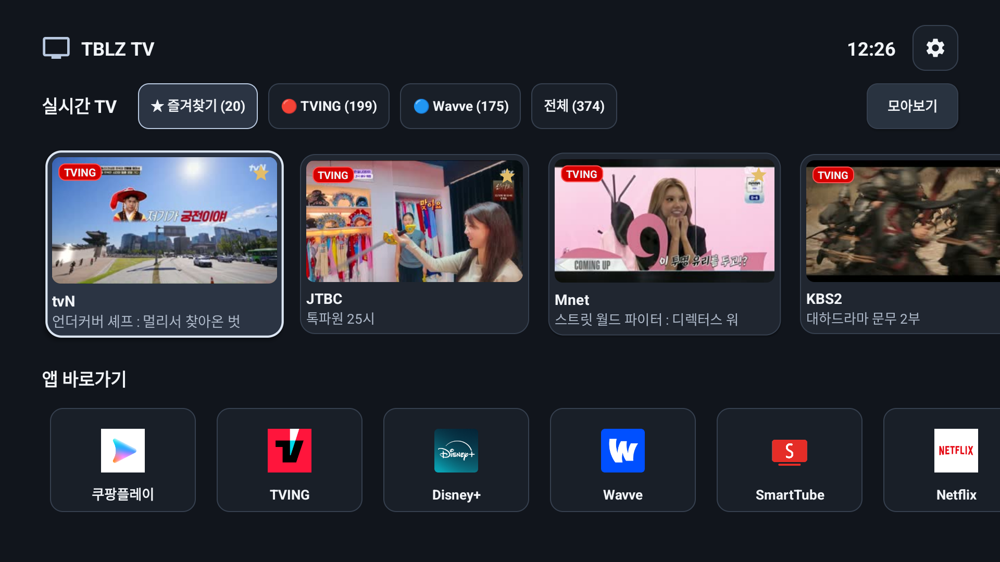

# TBLZ TV Launcher

안드로이드 TV 셋톱박스용 홈 런처입니다. TVING·Wavve 실시간 채널(360개 이상)을 한 화면에서 고르고 바로 재생합니다.

> 비공식 개인 프로젝트입니다. TVING·Wavve와 관계가 없으며, 재생하려면 각 서비스의 본인 계정과 이용권이 필요합니다.
> TVING, Wavve 등은 각 소유자의 상표입니다.

## 주요 기능

- TVING·Wavve 실시간 채널 통합 목록과 EPG(지금 방송 중, 진행률)
- 카테고리 모아보기, 즐겨찾기(★), 리모컨 채널 전환
  - 메인 채널 행은 마지막에서 오른쪽을 누르면 처음, 처음에서 왼쪽을 누르면 마지막 채널로 이어집니다. 좌우 연속 입력 중에는 채널 행 안에 포커스를 유지하고, 위 방향키로 상단 메뉴에 이동합니다.
  - 메인 화면에서 재생하면 즐겨찾기 채널만 순환하고, 모아보기에서 재생하면 전체 채널 순서대로 전환합니다.
  - 즐겨찾기가 없어도 선택한 채널은 재생하며, 위·아래로 전체 채널에 넘어가지 않습니다.
- TVING Non-DRM HLS(Kotlin 복호화)와 Widevine DRM, Wavve 1080p FHD 재생
- TVING 로그인(TVING 아이디·CJ ONE·네이버·카카오·Apple), 만료된 accessToken 자동 갱신
- 부팅 시 마지막 채널 자동 재생, 홈 화면 앱 바로가기
  - 앱 바로가기를 길게 누르면 좌우로 이동할 수 있습니다. 확인은 위치 저장, 위쪽 X는 바로가기 삭제, 뒤로는 이동 취소입니다.
- 네이티브 `.so` 없음 (Android 7.0 / API 24 이상)

## 화면



## 설치

[최신 릴리스](https://github.com/a77ila2000/TBLZ-TVLauncher/releases/latest)에서 APK를 받아 설치합니다. 기존 설치본과 서명이 같으면 업데이트 설치로 로그인·즐겨찾기·앱 순서를 유지할 수 있습니다.
설치 방법은 [설치 설명서](docs/1.설치설명서.txt), 화면별 조작은 [기능 설명서](docs/2.기능설명서.txt)를 참고하세요.

## 빌드

- JDK 17 이상, Android SDK Platform 37
- Gradle Wrapper 9.5.1, Android Gradle Plugin 9.2.1

```bash
./gradlew assembleRelease
```

`local.properties`에 `sdk.dir`을 적거나 `ANDROID_HOME`을 설정해야 합니다. release 빌드도 debug 서명 설정을 사용하므로,
결과 APK는 빌드한 PC의 debug 키로 서명됩니다.

채널 전환 회귀 테스트: `./gradlew testDebugUnitTest`.

## 소스 구성

`app/src/main/java/com/tblz/tvlauncher/` 아래:

| 경로 | 내용 |
|---|---|
| `engine/` | TVING·Wavve API, 스트림 URL 복호화(`TblzCipher`), TVING 세션 갱신, 설정 저장 |
| `player/` | Media3 ExoPlayer 기반 실시간 플레이어 |
| `ui/` | 홈·모아보기·설정·로그인 다이얼로그와 목록 어댑터 |
| `model/` | 채널·EPG·재생 정보 모델 |
| `receiver/` | 부팅 시 자동 재생 |

## 버전

[변경 내역](CHANGELOG.md)

v1.0.26 (versionCode 27). [APK와 SHA-256 다운로드](https://github.com/a77ila2000/TBLZ-TVLauncher/releases/tag/v1.0.26).

홈·모아보기·설정의 색상, 글자 위계, 카드와 버튼 포커스를 정리했습니다. 채널 순환·앱 편집·로그인·재생 로직은 유지했습니다. [디자인 적용 및 검증 기록](docs/design-v1.0.26.md).
